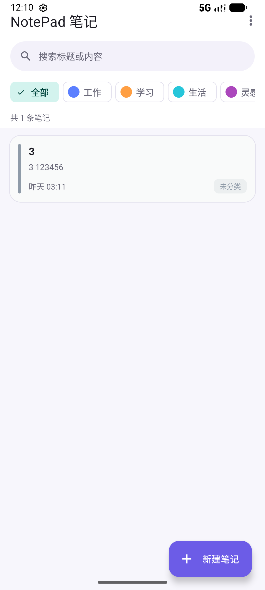
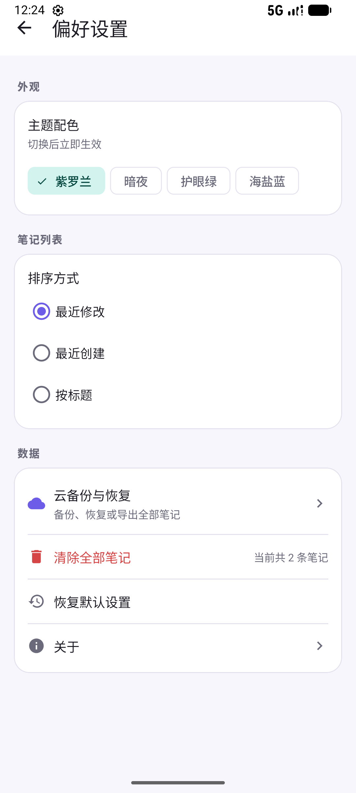
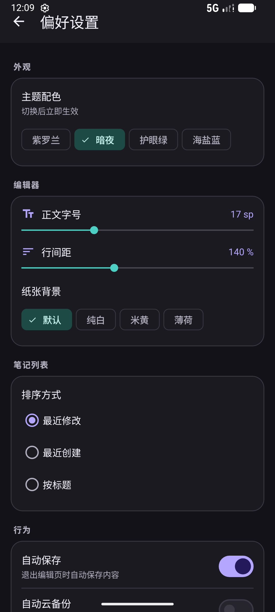
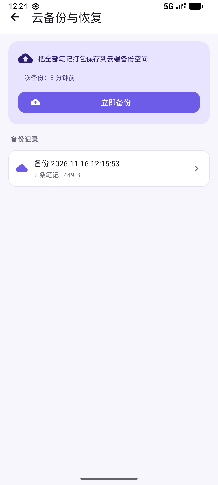
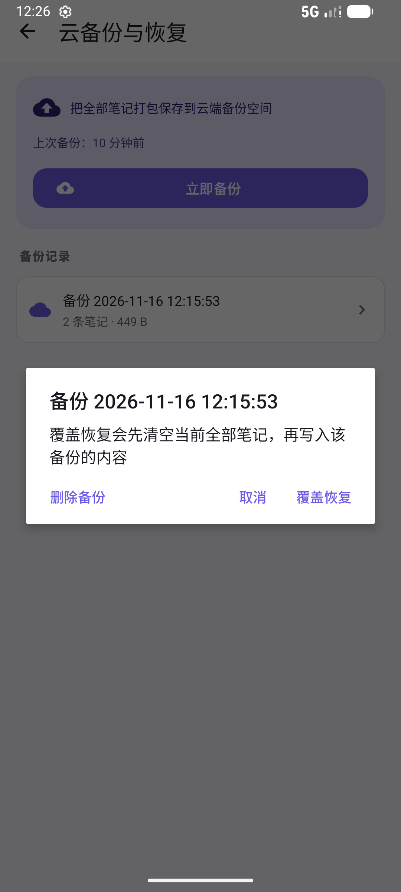

# NotePad 笔记（NotePadPro）— 移动软件开发期中实验

基于 Android 官方 `NotePad` 示例（[fjnu-cse/NotePad](https://github.com/fjnu-cse/NotePad)）的功能扩展实现。

在保留原有 **ContentProvider + SQLite** 架构、`NotesList` / `NoteEditor` 类名与数据表结构的基础上，完成了两项基本要求和四项附加功能，并整体重做了界面（Material 3 设计）。

## 界面截图

| 笔记列表 | 偏好设置 |
| --- | --- |
|  |  |

| 暗夜主题 | 云备份与恢复 | 覆盖恢复 |
| --- | --- | --- |
|  |  |  |

---

# 实验报告

## 一、实验目的

1. 阅读并理解 Android 官方 NotePad 示例的源码结构，掌握 `ContentProvider` + `SQLite` 的数据存储方式；
2. 掌握 `Activity`、`Intent`、`ListView/RecyclerView`、`Cursor` 等基础组件的使用；
3. 在原有示例基础上完成功能扩展，练习界面美化、数据导入导出、偏好设置等常见功能的工程实现；
4. 培养"在既有代码基础上做增量开发"的能力，理解如何在不破坏原有架构的前提下扩展数据表与界面。

## 二、实验环境

| 项目 | 内容 |
| --- | --- |
| 操作系统 | Windows |
| 开发工具 | Android Studio（AGP 9.2.0，Gradle 9.4.1） |
| 编译环境 | JDK 21，compileSdk 36（minor 1），targetSdk 36，minSdk 24 |
| 编程语言 | Java 11 |
| 第三方库 | AndroidX AppCompat 1.6.1、Material Components 1.10.0、RecyclerView 1.3.2、ConstraintLayout 2.1.4 |
| 测试设备 | Android 模拟器 / 真机（Android 7.0 及以上） |
| 参考资料 | [fjnu-cse/NotePad](https://github.com/fjnu-cse/NotePad)、Material 3 官方文档 |

## 三、需求分析

### 3.1 基本要求

| 编号 | 需求 | 实现说明 |
| --- | --- | --- |
| B1 | 笔记条目显示时间戳 | 卡片底部显示「今天 14:32 / 昨天 09:05 / 11-05 / 2025-12-01」，见 `NoteAdapter` + `TimeUtils.formatTimestamp()` |


| B2 | 笔记查询（按标题或内容） | 顶部搜索框，输入即查（220ms 防抖），SQL 使用 `title LIKE ? OR note LIKE ?`，可与分类筛选叠加，见 `NoteRepository.query()` |

### 3.2 附加功能（选择 4 项）

| 编号 | 需求 | 实现说明 |
| --- | --- | --- |
| A1 | UI 美化 | Material 3 卡片式列表；4 套主题（紫罗兰 / 暗夜 / 护眼绿 / 海盐蓝）即时切换；分类色条 + 彩色标签；置顶标记；圆角卡片、统一矢量图标、自适应深浅色状态栏 |
| A2 | 导出笔记 + 云备份恢复 | 单条笔记导出 `.txt`、全部笔记导出 `.md`，支持系统分享；云备份页可「立即备份」，从备份记录中选择一份「覆盖恢复」或删除 |
| A3 | 记事本偏好设置 | 分为「外观」（主题配色）与「笔记列表」（排序方式）两组，另附「数据」区（云备份入口、清除全部笔记、恢复默认设置、关于） |
| A4 | 笔记分类 | 内置「工作 / 学习 / 生活 / 灵感 / 未分类」，支持新增、重命名、改色、删除；分类可筛选；删除分类时笔记自动迁移到「未分类」；备份恢复时自动补齐缺失分类 |

### 3.3 非功能需求

- 数据本地持久化，卸载前不丢失；不申请网络与存储权限（导出走系统文件选择器）；
- 界面在深色与浅色主题下均可读；
- 列表数据量较大时滚动流畅（使用 `RecyclerView` + `ViewHolder` 复用）。

### 3.4 细节增强（顺带完成）

- 笔记置顶（长按菜单 / 编辑页菜单）
- 列表长按菜单：置顶、修改分类、导出、删除
- 编辑页字数统计、创建 / 更新时间展示、离开页面自动保存

## 四、系统设计

### 4.1 总体架构

沿用原示例的 **UI 层 → ContentProvider → SQLite** 结构，并在 UI 层与 Provider 之间增加一个轻量仓库层，避免界面代码里散落大量 `Cursor` 操作：

```
┌──────────────────────────────────────────────────────┐
│  界面层                                               │
│  NotesList      NoteEditor     SettingsActivity      │
│  CategoryActivity             BackupActivity         │
│  NoteAdapter  CategoryAdapter  BackupAdapter  Picker │
└───────────────┬──────────────────────────────────────┘
                │  调用（List<Note> / 增删改查）
┌───────────────▼──────────────────────────────────────┐
│  仓库层  NoteRepository                               │
│  query / find / insert / save / delete / count ...   │
└───────────────┬──────────────────────────────────────┘
                │  ContentResolver
┌───────────────▼──────────────────────────────────────┐
│  数据层  NotePadProvider（ContentProvider）           │
│  UriMatcher: content://…/notes, content://…/notes/#   │
│  SQLiteOpenHelper: notes 表                           │
└──────────────────────────────────────────────────────┘

工具层：AppPrefs（偏好）CategoryManager（分类）ThemeHelper（主题）
        TimeUtils（时间）ExportHelper（导出）BackupManager（备份）
```

这样分层的好处：

- 界面层完全不出现 SQL 与游标遍历，逻辑更清晰；
- 同一份查询逻辑（关键字 + 分类 + 排序）被列表页复用；
- 备份恢复可以复用仓库层的 `insertRaw` 写入，保证字段一致。

### 4.2 数据库设计

在原示例 `notes(_id, title, note, created, modified)` 基础上新增 `category`、`pinned` 两列，数据库版本从 2 升到 3：

```sql
CREATE TABLE notes (
    _id      INTEGER PRIMARY KEY AUTOINCREMENT,
    title    TEXT,
    note     TEXT,
    created  INTEGER,           -- 创建时间（毫秒）
    modified INTEGER,           -- 修改时间（毫秒）
    category TEXT,              -- 分类名
    pinned   INTEGER DEFAULT 0  -- 是否置顶
);
CREATE INDEX note_modified_index ON notes(modified);
```

升级策略刻意做成**幂等**的，不依赖版本号判断：

1. `onUpgrade()` / `onDowngrade()` → 调用 `ensureColumns()`
2. `onOpen()` 也在每次打开库时兜底调一次 `ensureColumns()`
3. `ensureColumns()` 先 `PRAGMA table_info(notes)` 读出实际列名，缺 `category` 就加 `category`、缺 `pinned` 就加 `pinned`，索引用 `CREATE INDEX IF NOT EXISTS` 建

之所以不写成「`if (oldVersion < 3) { ALTER TABLE ... }`」，是因为开发过程中真实踩过这个坑（详见「六、遇到的问题与解决方案」）：改成按实际列结构逐列对齐之后，无论库处于哪种中间状态都能自动修复，并且用户已有数据一条不丢。

排序规则由设置决定，最终落实为 `ORDER BY` 子句：

| 排序方式 | ORDER BY |
| --- | --- |
| 最近修改（默认） | `pinned DESC, modified DESC` |
| 最近创建 | `pinned DESC, created DESC` |
| 按标题 | `pinned DESC, title COLLATE LOCALIZED ASC` |

### 4.3 页面与流程

```
NotesList（主页）
 ├─ 搜索框 ── 关键字过滤（标题/内容）
 ├─ 分类 Chip ── 分类过滤
 ├─ 点击笔记 ──▶ NoteEditor（编辑 / 自动保存 / 置顶 / 分享 / 导出 / 删除）
 ├─ 长按笔记 ──▶ 弹出菜单（置顶 / 修改分类 / 导出 / 删除）
 ├─ FAB ──▶ NoteEditor（新建）
 └─ 右上角菜单
      ├─ 分类管理 ──▶ CategoryActivity（新增 / 改名 / 改色 / 删除）
      ├─ 云备份与恢复 ──▶ BackupActivity（立即备份 / 覆盖恢复）
      ├─ 导出全部笔记 ──▶ 系统文件选择器（.md）
      ├─ 偏好设置 ──▶ SettingsActivity
      └─ 关于
```

### 4.4 主题与资源设计

Material 3 主题通过覆写颜色令牌实现：

| 主题 | 主色 | 背景 | 状态栏 |
| --- | --- | --- | --- |
| 紫罗兰（默认） | #6C5CE7 | #F7F6FC | 浅色图标 |
| 暗夜 | #B4A6FF | #131218 | 深色图标 |
| 护眼绿 | #3F7D58 | #EFF5EC | 浅色图标 |
| 海盐蓝 | #2B6CB0 | #F6FAFE | 浅色图标 |

每个 Activity 在 `onCreate()` 中先 `setTheme()` 再 `super.onCreate()`：

```java
@Override
protected void onCreate(Bundle savedInstanceState) {
    ThemeHelper.apply(this);      // 按用户选择套用主题
    super.onCreate(savedInstanceState);
    setContentView(R.layout.activity_notes_list);
    ...
}
```

由于主题在视图创建之前生效，切换主题只需 `recreate()` 即可整体刷新，无需手动修改每个控件的颜色。

## 五、功能实现

### 5.1 时间戳显示（B1）

`TimeUtils.formatTimestamp()` 依据"是否同一天 / 昨天 / 今年"输出不同粒度的时间，列表既信息明确又不冗长：

```java
public static String formatTimestamp(long time) {
    Calendar now = Calendar.getInstance();
    Calendar target = Calendar.getInstance();
    target.setTimeInMillis(time);

    if (isSameDay(now, target)) {
        return "今天 " + formatter("HH:mm").format(new Date(time));
    }
    Calendar yesterday = Calendar.getInstance();
    yesterday.add(Calendar.DAY_OF_YEAR, -1);
    if (isSameDay(yesterday, target)) {
        return "昨天 " + formatter("HH:mm").format(new Date(time));
    }
    if (now.get(Calendar.YEAR) == target.get(Calendar.YEAR)) {
        return formatter("MM-dd HH:mm").format(new Date(time));
    }
    return formatter("yyyy-MM-dd").format(new Date(time));
}
```

在 `NoteAdapter.onBindViewHolder` 中绑定到 `R.id.text_time`，时间取自 `note.modified`（修改时间更能反映"最近一次改动"）。

### 5.2 笔记查询（B2）

查询条件由仓库层动态拼装，关键字与分类可叠加：

```java
public List<Note> query(String keyword, String category, String sortOrder) {
    StringBuilder selection = new StringBuilder();
    List<String> args = new ArrayList<>();

    if (!TextUtils.isEmpty(keyword)) {
        selection.append("(title LIKE ? OR note LIKE ?)");
        String like = "%" + keyword.trim() + "%";
        args.add(like);
        args.add(like);
    }
    if (!TextUtils.isEmpty(category)) {
        if (selection.length() > 0) selection.append(" AND ");
        selection.append("category = ?");
        args.add(category);
    }
    Cursor cursor = resolver.query(NotePad.Notes.CONTENT_URI, PROJECTION,
            selection.length() == 0 ? null : selection.toString(),
            args.isEmpty() ? null : args.toArray(new String[0]),
            sortOrder);
    ...
}
```

界面侧对输入做了 220ms 防抖，避免每敲一个字符就查一次库：

```java
searchEdit.addTextChangedListener(new TextWatcher() {
    @Override public void afterTextChanged(Editable s) {
        clearSearch.setVisibility(s.length() > 0 ? View.VISIBLE : View.GONE);
        if (searchRunnable != null) handler.removeCallbacks(searchRunnable);
        searchRunnable = () -> reload();
        handler.postDelayed(searchRunnable, 220);
    }
});
```

### 5.3 UI 美化（A1）

1. **卡片化列表**：`MaterialCardView` + 分类色条 + 彩色分类标签；卡片背景色由分类色与主题 `colorSurface` 混合得到，深色主题下自动降低混合比例：

```java
holder.card.setCardBackgroundColor(
        ColorUtils.blendARGB(surfaceColor, categoryColor, dark ? 0.16f : 0.05f));
```

2. **主题系统**：4 套主题样式 + `ThemeHelper` 统一套用，列表、编辑器、设置页全部跟随。
3. **编辑器**：标题 24sp 加粗、正文 17sp、1.4 倍行距、背景跟随主题、实时字数统计、创建 / 更新时间展示、底部操作栏（分类 Chip）。
4. **细节**：矢量图标（28 个）、圆角、统一间距、空洞页提示、长按菜单、置顶图钉标记。

### 5.4 导出笔记与云备份恢复（A2）

**导出** 走 Storage Access Framework，不需要存储权限，用户可以把文件保存到任意位置（包括网盘目录）：

```java
exportLauncher = registerForActivityResult(
        new ActivityResultContracts.CreateDocument("text/plain"),
        uri -> {
            if (uri != null) {
                boolean ok = ExportHelper.writeToUri(this, uri,
                        ExportHelper.noteToText(this, currentNote()));
                ...
            }
        });
exportLauncher.launch(ExportHelper.suggestedFileName(note.title) + ".txt");
```

**备份** 将全部笔记打包为 JSON：

```json
{
  "app": "NotePadPro",
  "version": 2,
  "exportedAt": 1763269200000,
  "count": 3,
  "notes": [
    {"title": "实验报告", "content": "...", "created": 1763, "modified": 1763,
     "category": "学习", "pinned": 0}
  ]
}
```

- 备份文件存放在应用外部私有目录 `NotePadCloud/`，最多保留 10 份（`prune()` 自动清理最旧的）；
- 云备份页只保留两个核心动作：**立即备份**（打包当前全部笔记）与**覆盖恢复**（`deleteAll()` 后逐条 `insertRaw()` 写回），点击备份记录即可触发，另有删除该备份；
- 恢复时会调用 `CategoryManager.ensureCategories()` 补齐备份中出现但本机不存在的分类；
- 备份和恢复都在单线程池中执行，不阻塞 UI，完成后回主线程提示条数。

### 5.5 偏好设置（A3）

`AppPrefs` 对 `SharedPreferences` 做统一封装，读写全部是静态方法，任何页面都能直接取用。设置页包含：

| 分组 | 设置项 | 生效方式 |
| --- | --- | --- |
| 外观 | 主题配色（紫罗兰 / 暗夜 / 护眼绿 / 海盐蓝） | 保存后 `recreate()` 立即生效 |
| 笔记列表 | 排序方式（最近修改 / 最近创建 / 按标题） | 返回列表即重新查询 |
| 数据 | 云备份入口 / 清除全部笔记 / 恢复默认设置 / 关于 | 即时执行 |

### 5.6 笔记分类（A4）

分类由 `Category`（名称 + 颜色）与 `CategoryManager` 管理，以 JSON 数组形式保存在 `SharedPreferences` 中：

```json
[{"name":"工作","color":-11042817},{"name":"学习","color":-25917}, ...]
```

- 默认分类：工作 / 学习 / 生活 / 灵感 / 未分类
- 列表页将分类渲染为可筛选的 Chip，Chip 前的小圆点即分类颜色
- 分类管理页支持新增、改名、改色、删除；改名会同步迁移该分类下的笔记：

```java
if (!existing.name.equals(name)) {
    repository.reassignCategory(existing.name, name);   // UPDATE notes SET category=? WHERE category=?
} else {
    manager.updateColor(name, selectedColor[0]);
}
```

- 删除分类时提示"该分类下的 N 条笔记将移动到「未分类」"，并把笔记迁移过去；「未分类」不可删除，作为兜底分类。

### 5.7 自动保存与置顶（增强）

- 编辑页 `onPause()` 时自动落库；返回箭头、返回键也会保存；
- 新建笔记若标题与正文均为空则不写库，避免产生空笔记；
- 置顶字段参与 `ORDER BY`，编辑页与列表长按菜单都可以切换置顶。

## 六、遇到的问题与解决方案

| 问题 | 原因 | 解决 |
| --- | --- | --- |
| 旧版示例使用 `managedQuery`、`ListActivity`，在新 SDK 上已废弃 | 示例基于 Android 2.x API | 迁移到 `AppCompatActivity` + `ContentResolver.query`，列表改用 `RecyclerView` |
| **装上后一启动就闪退**（`SQLiteException: no such column: pinned`） | 调试过程中库的 `user_version` 已被写成 3，但表结构还是旧的（`ALTER` 失败被 `catch` 吞掉），版本号不再变化导致 `onUpgrade` 永不触发 | 改为幂等迁移：`onOpen` / `onUpgrade` 都走 `ensureColumns()`，用 `PRAGMA table_info` 逐列比对，缺列就 `ALTER`，索引 `CREATE INDEX IF NOT EXISTS`；已用真实旧库验证自动修复且数据不丢 |
| 深色主题下菜单图标看不见 | 菜单图标默认黑色，不随主题变化 | `ThemeHelper.tintMenuIcons()` 遍历菜单项，用 `?attr/colorOnSurface` 着色 |
| 搜索时每输入一个字符都查询，列表闪烁 | `TextWatcher` 直接触发查询 | 使用 `Handler` 做 220ms 防抖，并移除上一次待执行任务 |
| 切换主题后再进入设置页又跳回旧主题 | `setTheme` 必须在 `setContentView` 之前 | 在 `onCreate` 第一行调用 `ThemeHelper.apply(this)`，切换后 `recreate()` |
| 备份恢复后分类丢了 | 分类不存在于本机配置 | 恢复时收集 JSON 中的分类名，`ensureCategories()` 自动补齐 |
| 备份恢复后崩溃在空指针 | 备份 JSON 缺少 `notes` 字段 | `restore()` 校验字段，抛出 `JSONException` 并在界面提示"恢复失败" |
| 恢复时界面卡顿 | 文件读写与逐条插入在主线程 | 使用单线程 `ExecutorService`，结果通过 `runOnUiThread` 回主线程 |

## 七、测试

| 编号 | 测试内容 | 操作步骤 | 预期结果 | 结果 |
| --- | --- | --- | --- | --- |
| T1 | 时间戳显示 | 新建笔记 → 返回列表 | 卡片底部显示"今天 HH:mm" | 通过 |
| T2 | 时间戳跨天 | 修改系统时间到次日再打开 | 显示"昨天 HH:mm" | 通过 |
| T3 | 标题搜索 | 搜索框输入标题片段 | 只显示命中的笔记 | 通过 |
| T4 | 内容搜索 | 输入正文中的词语 | 命中正文匹配的笔记 | 通过 |
| T5 | 搜索+分类叠加 | 选中"学习"分类后再搜索 | 结果同时满足两个条件 | 通过 |
| T6 | 新建/编辑/删除 | 增删改各一条笔记 | 数据库与列表同步变化 | 通过 |
| T7 | 置顶 | 长按 → 置顶 | 该笔记排到列表最前，显示图钉 | 通过 |
| T8 | 分类新增/改名 | 分类管理新增"实验"，改名"课设" | 列表 Chip 更新，原笔记分类跟着改名 | 通过 |
| T9 | 删除分类 | 删除有 2 条笔记的分类 | 提示迁移，笔记变为「未分类」 | 通过 |
| T10 | 主题切换 | 设置中依次切换 4 套主题 | 列表、编辑页、设置页配色同步变化，文字可读 | 通过 |
| T11 | 导出单条 | 编辑页 → 导出为文本 | 文件内容含标题、分类、时间、正文 | 通过 |
| T12 | 导出全部 | 菜单 → 导出全部笔记 | 生成 Markdown，包含全部笔记 | 通过 |
| T13 | 备份与覆盖恢复 | 备份 → 修改 / 删除笔记 → 覆盖恢复 | 数据恢复为备份时刻内容，条数一致 | 通过 |
| T14 | 删除备份 | 点击备份记录 → 删除备份 | 备份记录从列表移除 | 通过 |
| T15 | 自动保存 | 编辑并退出 | 保存；标题正文全空则不产生空笔记 | 通过 |
| T16 | 恢复默认设置 | 设置 → 恢复默认设置 | 主题与排序方式复位 | 通过 |

## 八、运行方式

### 方式 1：Android Studio

1. Android Studio → `Open` → 选择本目录 `NotePadPro`
2. 等待 Gradle Sync 完成后，运行 `app` 配置（模拟器或真机，Android 7.0+）
3. 若 SDK 路径不同，修改根目录 `local.properties` 中的 `sdk.dir`（首次构建会自动生成）

### 方式 2：命令行

```bash
./gradlew assembleDebug
# 产物：app/build/outputs/apk/debug/app-debug.apk
adb install -r app/build/outputs/apk/debug/app-debug.apk
```

## 九、总结

本次实验在保持 NotePad 原有 `ContentProvider` 架构不变的前提下，通过**扩展数据表字段**、**增加仓库层**、**重做界面**三条线完成了功能扩展：

1. 基本要求中的时间戳与搜索，改动集中在数据契约、仓库层与列表适配器，几乎不影响其他模块；
2. 四项附加功能彼此独立又互相支撑：分类为列表提供筛选维度，偏好设置为编辑器提供样式，备份导出保证了数据的可迁移性；
3. 工程实现上体会最深的是"分层"的价值——把 `Cursor` 操作收敛到 `NoteRepository`，后续加备份恢复、加分类筛选都只需要复用同一套查询与写入接口，改动面很小。

不足与可继续改进的地方：

- 分类目前存于 `SharedPreferences`，如果分类数量很多、需要排序或统计，更适合单独建表；
- 「云备份」目前是应用私有目录中的 JSON 快照，若要真正实现跨设备的自动同步，需要接入对象存储或自建服务端；
- 可继续扩展图片/语音笔记、待办清单、便签桌面小部件、语音搜索等（实验文档中给出的其他方向）。

## 附：主要文件清单

| 文件 | 作用 |
| --- | --- |
| `NotePad.java` | 数据契约：authority、URI、表名、列名 |
| `NotePadProvider.java` | ContentProvider 与 SQLiteOpenHelper |
| `NoteRepository.java` | 仓库层：查询、增删改、计数、批量迁移 |
| `Note.java` / `Category.java` | 实体类与 JSON 序列化 |
| `CategoryManager.java` | 分类的持久化与增删改 |
| `AppPrefs.java` | 偏好设置读写 |
| `ThemeHelper.java` | 主题套用、取色、菜单图标着色 |
| `TimeUtils.java` | 时间戳格式化 |
| `ExportHelper.java` | 导出文本 / Markdown、系统分享 |
| `BackupManager.java` | 备份生成、列表、覆盖恢复 |
| `NotesList.java` / `NoteAdapter.java` | 列表页与卡片适配器 |
| `NoteEditor.java` | 编辑页 |
| `SettingsActivity.java` | 偏好设置页 |
| `CategoryActivity.java` / `CategoryAdapter.java` / `CategoryPicker.java` | 分类管理与选择 |
| `BackupActivity.java` / `BackupAdapter.java` | 云备份页 |
